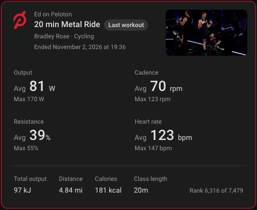

# Peloton for Home Assistant

[](https://github.com/hacs/integration)
[](https://github.com/edwork/homeassistant-peloton-sensor/actions/workflows/validate.yml)
[](https://github.com/edwork/homeassistant-peloton-sensor/actions/workflows/tests.yml)

A custom integration that shows your current or latest Peloton workout in
Home Assistant. A binary sensor is on while a workout is in progress, and
sensors show the workout's totals, averages and live values such as output,
cadence and heart rate.

It was written to turn on a fan when a ride starts. The same sensors can drive
lights or scenes, notifications, or a dashboard of recent workouts.

This project is not affiliated with or endorsed by Peloton. It uses Peloton's
unofficial API, which can change without notice.

- [Requirements](#requirements)
- [Installation](#installation)
- [Configuration](#configuration)
- [Entities](#entities)
- [Data updates](#data-updates)
- [Examples and blueprint](#examples-and-blueprint)
- [Workout card](#workout-card)
- [Upgrading from 0.x](#upgrading-from-0x)
- [Known limitations](#known-limitations)
- [Troubleshooting](#troubleshooting)
- [Removal](#removal)
- [Development](#development)
- [Contributors](#contributors)
- [Support](#support)

## Requirements

- Home Assistant 2026.3.1 or newer.
- A Peloton account that can log in with a username or email address and a
  password. Accounts that only sign in with Apple or Google, and accounts with
  multi-factor authentication, are not supported.

The integration has no Python dependencies beyond Home Assistant itself.

## Installation

### Marketplace or HACS

1. On Home Assistant 2026.11 and newer, go to Settings > Marketplace, search
   for "Peloton" and download it. On older versions, do the same in HACS.
2. Restart Home Assistant.
3. Add the integration (see [Configuration](#configuration)).

### Manual

1. Download `peloton.zip` from the
   [latest release](https://github.com/edwork/homeassistant-peloton-sensor/releases/latest).
2. Extract it into `<config>/custom_components/peloton/`, so that
   `manifest.json` is at `<config>/custom_components/peloton/manifest.json`.
3. Restart Home Assistant.
4. Add the integration (see [Configuration](#configuration)).

## Configuration

Go to Settings > Devices & services > Add integration, choose Peloton and
log in with your Peloton username (or email address) and password.

The password is used once, to get access tokens from Peloton, and is not
stored. Home Assistant stores the username, an access token and a refresh
token. The integration renews the access token before it expires (Peloton's
tokens last 48 hours), so it does not log in again on restarts or polls.

Each Peloton account is one entry and one device. To follow several accounts,
add the integration once for each.

### Reauthentication and reconfiguration

If Peloton stops accepting the stored tokens, polling stops, the entities
become unavailable and Home Assistant asks you to reauthenticate. Enter the
password of the same account. Reauthentication uses the stored username; if
your Peloton username or email address has changed, use Reconfigure instead.

Reconfigure (in the entry's three-dot menu) logs in again with a username and
password. It must be the same Peloton account. To switch to a different
account, delete the entry and add the integration again.

### Options

The entry's Configure button opens these options:

| Option | Default | Range | Description |
| --- | --- | --- | --- |
| Interval between workouts | 15 s | 10 to 60 s | How long it can take to notice that a workout started. |
| Interval during a workout | 10 s | 5 to 60 s | How often live values update during a workout. |
| Longest workout without a class length | 240 min | 30 to 600 min | A workout that is not a class (for example Just Ride), or a class without a length, that Peloton still reports as in progress after this long is treated as ended. |

Classes that Peloton still reports as in progress 15 minutes after the class
length are treated as ended, so an abandoned workout does not keep the
workout sensor on.

## Entities

The device is named "<first name> on Peloton", or "<username> on Peloton"
when the account has no first name. Entity ids start with that name in lower
case with underscores, for example
`binary_sensor.jane_on_peloton_workout` and
`sensor.jane_on_peloton_cadence_current`. Installs set up before version 1.0
keep their original entity ids.

Except for Total workouts and the workout counts, which cover the whole
account, the sensors describe the latest workout: the one in progress, or else
the most recent one. They do not add up several workouts or a day; long-term statistics
in Home Assistant do that (see the
[example dashboard](https://github.com/edwork/homeassistant-peloton-sensor/blob/master/examples/README.md#dashboard-view)).

| Entity | Unit | Description |
| --- | --- | --- |
| Workout | | Binary sensor, on while a workout is in progress. Attributes below. |
| Start time | | When the latest workout started. |
| End time | | When the latest workout ended; unknown while it is in progress. If Peloton reports the same start and end time, the start time plus the class length. |
| Duration | min | Class length of the latest workout. |
| Total work | Wh | Total work of the latest workout. During a workout it follows Total output (1 kJ is 0.2778 Wh); Peloton's exact value replaces it when the workout completes. Called "Power Output" before 1.0. |
| Total output | kJ | Total output of the latest workout, as shown by Peloton. |
| Total calories | kcal | Calories of the latest workout. |
| Active calories | kcal | Active calories of the latest workout, when Peloton reports them. |
| Distance | mi or km | Distance of the latest workout. |
| Leaderboard rank | | Leaderboard rank in the latest workout. |
| Leaderboard total users | | Number of people on that leaderboard. |
| Output average, max, current | W | Power output. |
| Cadence average, max, current | rpm | Cadence. |
| Resistance average, max, current | % | Resistance. |
| Speed average, max, current | mph or km/h | Speed. |
| Heart rate average, max, current | bpm | Heart rate, from a connected heart rate monitor. |
| Total workouts | | Number of workouts on the account. |
| Workout counts | | Number of workouts per type: bike bootcamp, cardio, cycling, meditation, row bootcamp, rowing, running, strength, stretching, tread bootcamp, walking and yoga. One sensor per type, disabled by default. |
| Stroke rate average, max, current | spm | Rower stroke rate. Disabled by default. |
| Split pace average, best, current | min/500m | Rower pace per 500 m, in decimal minutes (3.5 is 3:30). Best is the fastest pace. Disabled by default. |
| Stroke count | | Strokes in the latest rower workout. Disabled by default. |
| Pace average, best, current | min/mi or min/km | Tread pace, in decimal minutes. Best is the fastest pace. Disabled by default. |
| Incline average, max, current | % | Tread incline. Disabled by default. |
| Elevation | ft or m | Elevation gain of the latest tread workout. Disabled by default. |

Behaviour:

- Average and max values come from the latest workout and stay until the next
  workout starts.
- Current values are the latest sample during a workout. Between workouts
  and while a workout is paused, output, cadence, resistance, speed, stroke
  rate and incline are 0, and heart rate and both paces are unknown. A pace
  of 0 (not moving) is unknown too.
- Peloton reports no samples for roughly the first minute of a workout, so
  current values are unknown until then. The workout sensor is on from the
  start.
- A value Peloton does not report for a workout is unknown: cadence during a
  run, or most metrics during yoga or strength. The leaderboard sensors are
  unknown for workouts without a leaderboard.
- On an account without workouts, the latest-workout sensors are unknown and
  the current values are as between workouts.
- Total work, Total output, the calorie sensors and Stroke count are totals
  that restart with each workout, so their long-term statistics count every workout.
  Their last reset is the time the workout was created.
- Distance, speed and elevation follow the distance unit in your Peloton
  settings. Home Assistant converts them to its unit system on new installs;
  the unit can be changed in each entity's settings.
- Tread pace is in min/mi or min/km, following the distance unit in your
  Peloton settings. Home Assistant does not convert it, and it has no
  long-term statistics, so a change of that setting does not break any.
- The rower and tread sensors are disabled by default. Enable the ones you
  need in the device page. The workout count sensors are diagnostic entities,
  also disabled by default. They and Total workouts update when a workout starts or
  ends and once an hour.

### Workout binary sensor attributes

The attributes describe the latest workout and keep their values after it
ends; use the sensor's state to tell whether a workout is running. On an
account without workouts they are empty and `paused` is `false`.

| Attribute | Description |
| --- | --- |
| `workout_type` | Peloton's discipline slug, for example `cycling`, `running`, `caesar` (rowing), `circuit` (tread bootcamp), `strength` or `meditation`. |
| `device_type` | The device used, as reported by Peloton. |
| `ride_title` | Class title. |
| `ride_description` | Class description. |
| `workout_image` | URL of the class image. |
| `ftp` | Functional threshold power in W used for the workout, if any. |
| `instructor` | Instructor name. Empty for workouts without a class, such as Just Ride. |
| `paused` | `true` while the workout is paused. |

Templates read them with `state_attr()`, for example
`{{ state_attr('binary_sensor.jane_on_peloton_workout', 'ride_title') }}`.

## Data updates

The integration polls Peloton. Between workouts a poll is usually one
request, every 15 seconds by default, so a new workout shows up within about
that time. When a workout starts or ends, and once an hour, a poll also
fetches the workout details, the profile and the settings. During a workout the details and live values are fetched every 10
seconds by default. Both intervals are in the [options](#options).

If Peloton cannot be reached, the entities keep their last values for three
failed polls in a row and then become unavailable. When Peloton rate limits
requests, polling waits for the time Peloton asks for (at least one polling
interval, at most one hour), or backs off from one minute, doubling up to 15
minutes. If that wait is longer than three polling intervals, the entities
become unavailable right away. A rate limit while Home Assistant starts the
integration retries the setup no sooner than Peloton asks (Home Assistant
2026.11 and newer). If Peloton stops accepting the stored tokens,
see [Reauthentication](#reauthentication-and-reconfiguration).

## Examples and blueprint

[The examples](https://github.com/edwork/homeassistant-peloton-sensor/blob/master/examples/README.md) have a dashboard view, a markdown
card, and a blueprint that turns a fan on when a workout starts and off a set
time after it ends. Import the blueprint from Settings > Automations &
scenes > Blueprints > Import blueprint with this URL:

```text
https://github.com/edwork/homeassistant-peloton-sensor/blob/master/blueprints/automation/peloton/workout_fan.yaml
```

## Workout card

The integration includes a dashboard card, Peloton workout, that shows the
workout in progress and, between workouts, the latest workout. Home
Assistant loads the card on every page by itself; do not add it as a
dashboard resource. After installing or updating the integration, restart
Home Assistant. Then reload the browser page or the app, so that the browser
loads the new card. On a first install, reload after adding the Peloton
integration: the card is loaded from then on.



To add it, edit a dashboard, choose Add card and search for "Peloton
workout". With one Peloton account the card finds it without any settings.
With several accounts, choose the account in the card settings. The
smallest configuration in YAML is:

```yaml
type: custom:peloton-workout-card
```

### What the card shows

- During a workout: the class title (or the workout type when Peloton
  reports no title), the instructor, the workout type, the start time and
  "In progress". Each metric has a tile with the current value
  and the average and max (best for pace). Below the tiles are the totals and
  the leaderboard rank.
- Before the first data: Peloton reports no values for roughly the first
  minute of a workout. Until then the tiles show a dash, and for cycling,
  bike bootcamp, running, walking, tread bootcamp, rowing and row bootcamp
  the card says it is waiting for the first data from Peloton.
- While paused: "Paused", and the tiles show the averages and max, because
  Peloton reports no current values during a pause.
- Between workouts: "Last workout", with the end time, the averages and max
  of the latest workout, and its totals. Metrics without an average for that
  workout are left out.
- With no workouts on the account: "No workouts yet" and the number of
  workouts.
- When Peloton cannot be reached (the workout sensor is unavailable):
  "Unavailable" and no values. They return when the connection recovers.

Without a `metrics` setting, the card chooses the tiles from the workout
type. A metric is left out when all its sensors are disabled, so the rower
and tread metrics appear only after those sensors are enabled (see
[Entities](#entities)).

| Workout type | Metrics |
| --- | --- |
| Cycling, bike bootcamp, other types | Output, cadence, resistance, heart rate |
| Running, walking, tread bootcamp | Speed, pace, incline, heart rate |
| Rowing, row bootcamp | Output, stroke rate, split pace, heart rate |
| Strength, yoga, meditation, stretching, cardio | Heart rate |

During a workout, an automatic tile without any value so far is hidden once
Peloton sends data, for example heart rate without a heart rate monitor. Tapping a
tile or a total opens the sensor's details; tapping the header opens the
workout sensor's details.

The compact variant is one row with the name and a status: "In progress"
with the first two current values, "Paused", or "Last workout" with the
workout type and end time.

### Card configuration

| Key | Default | Description |
| --- | --- | --- |
| `device_id` | the only account | The Peloton device. Needed when more than one Peloton account is set up. |
| `name` | device name | Name shown above the title, for example "Jane on Peloton". |
| `variant` | `full` | `full`, or `compact` for one row. |
| `metrics` | automatic | Tiles to show, in order. Keys: `output`, `cadence`, `resistance`, `heart_rate`, `speed`, `pace`, `incline`, `stroke_rate`, `split_pace`. Empty chooses by workout type. Listed metrics are always shown, with a dash when there is no value, unless all their sensors are disabled. |
| `show_image` | `true` | Show the class image beside the title. Only in the full variant, on a card at least 434 pixels wide, such as a full-width card in a sections view on a computer. The browser loads the image from Peloton's server. |
| `show_logo` | `true` | Show the Peloton logo at the start of the header, in place of the workout type icon. Only in the full variant. |
| `show_totals` | `true` | Show total output, distance, calories and class length below the tiles. |
| `show_leaderboard` | `true` | Show "Rank R of T" when Peloton reports both numbers. |
| `tap_action` | more info | Action when the header (or the compact row) is tapped. The default opens the workout sensor's details. |
| `entities` | none | YAML only. Entity ids to use instead of the ones the card finds, keyed by the entity's translation key, for example `workout: binary_sensor.jane_on_peloton_workout`. Normally not needed. |

The card editor offers every key except `entities`. The card takes the full
width of a sections view by default, and the compact variant half of it.

### Theme variables

The card uses the colors of the current theme. These variables can be set in
a theme or with card-mod to change the colors of the card:

| Variable | Default | Used for |
| --- | --- | --- |
| `--peloton-active-color` | `--state-binary_sensor-active-color` | A workout in progress. |
| `--peloton-paused-color` | `--warning-color` | A paused workout. |
| `--peloton-idle-color` | `--secondary-text-color` | The last workout and no workouts, and the text of the Unavailable status. Its tint and the compact icon use `--state-unavailable-color`. |
| `--peloton-accent-color` | Peloton Red (`#df1c2f`) | The Peloton logo and, unless `--peloton-border-color` is set, the card's border. |
| `--peloton-border-color` | `--peloton-accent-color` | The card's border. Set it to `var(--divider-color)` for the usual Home Assistant border. |

### Show the card only during a workout

The card has no setting to hide itself. Use Home Assistant's visibility
condition on the workout sensor instead (in the card editor's Visibility
tab, or in YAML):

```yaml
type: custom:peloton-workout-card
visibility:
  - condition: state
    entity: binary_sensor.jane_on_peloton_workout
    state: "on"
```

## Upgrading from 0.x

Version 1.0 changes some names and values. The full list is in the
[changelog](https://github.com/edwork/homeassistant-peloton-sensor/blob/master/CHANGELOG.md). In short:

- Entity ids and history are kept, but display names changed (for example
  "Heart Rate: Average" is now "Heart rate average"), and "Power Output" is
  now "Total work".
- The workout sensor's attributes are snake_case: `Workout Type` is now
  `workout_type`, `Ride Title` is `ride_title`, and so on. Update templates
  that use them.
- Total output is now an energy sensor in kJ. Its recorded statistics are
  relabelled automatically.
- On the first start after the upgrade, the stored password is exchanged for
  tokens once and then deleted.
- Version 1.0 changes the stored configuration. Going back to 0.x means
  deleting the integration entry and adding it again.

## Known limitations

- Peloton has no public API. The integration uses the same endpoints as
  Peloton's web app, which can change at any time. [docs/api.md](https://github.com/edwork/homeassistant-peloton-sensor/blob/master/docs/api.md)
  lists them.
- Updates come from polling, not push, so automations react up to one polling
  interval after a workout starts.
- Only the latest workout is shown. Earlier workouts are not imported.
- Peloton limits login attempts per IP address. After several failed logins,
  wait a few minutes before trying again.
- The workout card shows no elapsed time and no class progress yet.
- The workout card's own text is in English only. Numbers, units and dates
  follow the Home Assistant language and user settings.
- Home Assistant Cast may not load the workout card by itself (not tested).
  If a cast dashboard shows "Custom element doesn't exist", add
  `/peloton_static/peloton-cards.js?v=1.1.0` as a JavaScript module resource
  (Settings > Dashboards, three-dot menu, Resources; needs advanced mode in
  the user profile), and change the version after each update, because
  browsers keep the file for up to 31 days. Loading the card twice is
  harmless.
- The workout card needs a browser from 2023 or later. It uses CSS container
  queries and `color-mix()`, which older browsers do not support.

## Troubleshooting

To log details, choose Enable debug logging on the integration's page, or add
this to `configuration.yaml` and restart:

```yaml
logger:
  logs:
    custom_components.peloton: debug
```

The integration does not write the password or tokens to the log. Error
messages can include your Peloton user id and workout ids, which are part of
request paths; remove them before posting a log in public.

When reporting a problem, attach the diagnostics file: go to Settings >
Devices & services > Peloton, open the entry's three-dot menu and choose
Download diagnostics. Tokens, the username, your first name, ids, class
titles and image URLs are removed from that file. The class description, the
instructor name and the workout time zone are kept.

### Workout card problems

- "Custom element doesn't exist: peloton-workout-card", or the card is
  missing from Add card: reload the browser page after adding the Peloton
  integration, or after restarting Home Assistant if the integration was
  updated. If the message stays, look in the log for "Peloton
  card file ... is missing; the workout card is not available". The release
  zip, which Marketplace, HACS and manual installs use, includes the card. A git checkout
  has no card until `scripts/build-frontend build` has been run (see
  [Development](#development)). The `cards` key of the diagnostics file
  shows the address the card is served from, or `null` when it is not.
- "The Peloton workout sensor is disabled or not set up yet.": enable the
  Workout binary sensor on the Peloton device page. On an install from before
  version 1.0 the message also shows until the integration has set up its
  entities once with version 1.0 or newer. Restart Home Assistant after the
  upgrade, and if the Peloton entry asks for reauthentication or shows an
  error, fix that first.
- "Choose a Peloton account in the card settings.": more than one Peloton
  account is set up. Choose one in the card editor, or set `device_id`.

## Removal

1. Go to Settings > Devices & services > Peloton, open the entry's three-dot
   menu and choose Delete. The integration revokes its refresh token with
   Peloton.
2. Remove the files: remove Peloton in Marketplace or HACS, or delete
   `<config>/custom_components/peloton/` for a manual install.
3. Restart Home Assistant.
4. If you added the workout card as a dashboard resource for Cast, delete it
   under Settings > Dashboards > Resources.

## Development

The integration needs Python 3.14. With a virtualenv on Python 3.14.2 or
newer:

- `scripts/setup` installs the lint and test dependencies and the pre-commit
  hooks.
- `scripts/lint` runs ruff, codespell, yamllint, zizmor and file checks.
- `scripts/test` runs the tests with coverage.
- `scripts/develop` runs Home Assistant with this checkout's integration and
  a config in `./config`.

On hosts without Python 3.14, `scripts/docker-check` runs the lint and tests
in a container, and `scripts/dev-docker` starts a disposable Home Assistant
container on port 8124. `scripts/api_debug.py` logs in with the integration's
client and prints a summary of the account and the latest workout.

The workout card is written in TypeScript with Lit in `frontend/` and
bundled with esbuild into `custom_components/peloton/dist/peloton-cards.js`,
which is not committed. `scripts/build-frontend` runs the Node tooling in a
container, with the Node version from `frontend/.nvmrc`:

- `scripts/build-frontend` (or `all`) installs the packages, then runs the
  lint, the type check, the tests and the build.
- `install` installs the packages into `frontend/node_modules`; run it once
  and after `package-lock.json` changes. The other modes need it.
- `build` writes the bundle. Run it before starting or restarting Home
  Assistant with `scripts/develop` or `scripts/dev-docker`, then reload the
  browser page.
- `watch` rebuilds the bundle on every change.
- `lint`, `typecheck` and `test` run one check; `format` applies the Biome
  formatter.

`tests/test_card_fixtures.py` writes what the card reads from Home Assistant
(states, attributes and translation keys) for several workout scenarios to
`frontend/test/fixtures/`, and fails when the files are out of date. After an
intended change to entities or attributes, run the tests once with
`PELOTON_UPDATE_CARD_FIXTURES=1` and then the card tests.

Releases are published from the GitHub releases page. A workflow checks the
tag, runs the tests, builds the workout card, sets the version in
`manifest.json` and attaches `peloton.zip`, which Marketplace and HACS
install.

## Contributors

Thanks to everyone who has contributed code, testing and research, including
[RobertD502](https://github.com/RobertD502),
[elahd](https://github.com/elahd),
[Miablo](https://github.com/Miablo),
[tony1661](https://github.com/tony1661),
[philh30](https://github.com/philh30),
[superm1](https://github.com/superm1),
[justmedude](https://github.com/justmedude),
[carpii](https://github.com/carpii),
[skitzo2000](https://github.com/skitzo2000),
[scribblrsam](https://github.com/scribblrsam),
[ljhardy](https://github.com/ljhardy),
[likwidoxigen](https://github.com/likwidoxigen),
[marthoc](https://github.com/marthoc),
[bakerkj](https://github.com/bakerkj) and
[willieb9000](https://github.com/willieb9000).

Versions before 1.0 used [pylotoncycle](https://github.com/justmedude/pylotoncycle)
to talk to Peloton. Thanks to its author and contributors.

## Support

- Bugs and feature requests:
  [GitHub issues](https://github.com/edwork/homeassistant-peloton-sensor/issues).
- Discussion: the
  [Peloton thread](https://community.home-assistant.io/t/peloton-support/72555)
  on the Home Assistant Community forum.
- If you would like to support the project, you can
  [buy me a coffee](https://www.buymeacoffee.com/edwork).
